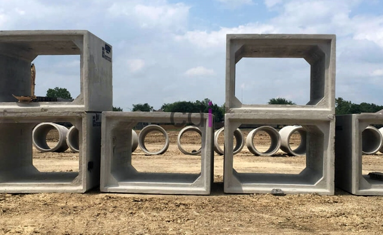

**Jual Box Culvert Precast di Cempaka Baru Jakarta** – Hai Mitra CDI! Apakah Anda sedang mencari solusi drainase yang handal dan efisien di Cempaka Baru Jakarta? Kami hadir untuk menawarkan Box Culvert Precast berkualitas tinggi, dirancang khusus untuk kebutuhan sistem drainase modern. Mari kita bahas lebih lanjut bagaimana produk ini bisa menjadi solusi tepat untuk proyek Anda!

Drainase yang baik adalah fondasi penting bagi lingkungan yang sehat dan nyaman. Nah, untuk mencapai sistem drainase optimal, Box Culvert Precast adalah pilihan cerdas. Produk ini, terbuat dari beton pracetak berkualitas, dirancang untuk mengalirkan air hujan dan limbah dengan efektif. Di CDI, kami mengerti betul kebutuhan proyek Anda, dan menyediakan beragam jenis Box Culvert Precast yang sesuai dengan spesifikasi yang Anda inginkan.



**Tipe Mutu Box Culvert Precast yang Tersedia di Cempaka Baru Jakarta**

## Apa Kelebihan Memilih Box Culvert Precast dari CDI di Cempaka Baru Jakarta?

*   **Daya Tahan Luar Biasa:** Box Culvert Precast yang kami sediakan dibuat dengan material beton premium, menjamin ketahanan terhadap cuaca ekstrem dan tekanan berat. Ini berarti investasi jangka panjang tanpa khawatir perbaikan sering.
*   **Pemasangan Cepat & Mudah:**  Desain pracetak memungkinkan pemasangan yang cepat dan sederhana di lapangan. Tidak perlu lagi proses konstruksi rumit yang memakan waktu!
*   **Fleksibilitas Dimensi:** Kami menyediakan berbagai pilihan dimensi Box Culvert Precast, dari ukuran kecil hingga besar. Pilih yang paling sesuai dengan kebutuhan proyek drainase atau gorong-gorong Anda.
*   **Struktur yang Kokoh:** Produk kami memiliki struktur yang stabil dan kuat, mampu menahan beban tinggi tanpa bergeser. Ini memastikan fungsi drainase tetap lancar dan optimal.
*   **Efisiensi Waktu Pengerjaan:** Penggunaan Box Culvert Precast mempercepat penyelesaian proyek drainase atau gorong-gorong. Proses produksi yang terstandarisasi dan pemasangan mudah membantu menghemat waktu dan biaya.

## Aplikasi Box Culvert Precast di Cempaka Baru Jakarta: Solusi Drainase dan Gorong-Gorong yang Andal

*   **Drainase Jalan Utama:** Ideal untuk mengelola volume air besar di jalan utama, dengan daya tahan tinggi terhadap beban lalu lintas.
*   **Drainase Perumahan:**  Mencegah genangan air dan memastikan sistem drainase perumahan berfungsi optimal, bahkan saat musim hujan tiba.
*   **Pembuatan Gorong-Gorong:** Solusi efektif dan tahan lama untuk proyek pembuatan gorong-gorong yang berkualitas.
*   **Drainase Zona Industri:** Memenuhi kebutuhan drainase berat dan tahan lama pada area industri yang membutuhkan performa tinggi.

## Daftar Harga Box Culvert Precast di Cempaka Baru Jakarta per Satuan:



Catatan: Harga Box Culvert Precast di Cempaka Baru Jakarta bervariasi tergantung tipe, mutu, dan ukuran produk.

## Mengapa Memilih Box Culvert Precast dari CDI Dibanding Drainase Konvensional?

*   **Biaya Efisien:**  Box Culvert Precast menawarkan biaya yang lebih kompetitif dibandingkan konstruksi drainase konvensional, membantu Anda menghemat anggaran proyek.
*   **Kualitas Terjamin:** Produk kami diproduksi dengan teknologi mutakhir dan material berkualitas tinggi, menjamin performa dan daya tahan yang unggul.
*   **Efisiensi Aliran Air:** Didesain khusus untuk menciptakan saluran yang efisien, memastikan sirkulasi air berjalan lancar dan optimal.
*   **Waktu Pengerjaan Lebih Singkat:** Proses instalasi yang cepat dan mudah menghemat waktu proyek Anda secara signifikan.

## Cara Mudah Memesan Box Culvert Precast di Cempaka Baru Jakarta

Berikut langkah-langkah mudah untuk memesan Box Culvert Precast dari kami:

*   **Langkah 1: Kirim Data Proyek Anda:** Kirimkan informasi lengkap melalui email customercdi@gmail.com, termasuk nama lengkap, alamat lengkap di Cempaka Baru Jakarta, dan detail kebutuhan Box Culvert Anda.
*   **Langkah 2: Dapatkan Konfirmasi dari Kami:** Tim kami akan segera memproses permintaan Anda dan mengirimkan konfirmasi berisi detail biaya, estimasi waktu pengiriman, dan opsi pembayaran.
*   **Langkah 3: Selesaikan Pembayaran:** Ikuti instruksi pembayaran yang kami berikan. Setelah pembayaran diterima, pesanan Anda akan segera diproses dan kami akan mengantarkannya sesuai jadwal.

## Tips Penting Sebelum Membeli Box Culvert Precast di Cempaka Baru Jakarta

*   **Perencanaan Matang:** Pastikan Anda telah melakukan pengukuran dan perencanaan drainase dengan akurat sebelum memesan.
*   **Siapkan Material Pendukung:** Periksa kebutuhan material tambahan seperti besi beton, pasir, dan semen untuk pemasangan Box Culvert Precast.
*   **Konsultasikan dengan Ahli:** Diskusikan kebutuhan Anda dengan tim teknis kami untuk memastikan Anda memilih produk yang tepat sesuai standar kualitas dan spesifikasi proyek Anda.
*   **Verifikasi Detail Pesanan:** Sebelum melakukan pembayaran, pastikan Anda telah mengecek kembali biaya, jumlah, dan detail lain dalam penawaran resmi yang kami kirimkan.

Pemasangan Box Culvert Precast yang tepat di Cempaka Baru Jakarta memerlukan pertimbangan matang dan perhitungan yang akurat untuk memastikan sistem drainase berfungsi secara optimal. Jangan ragu untuk menghubungi kami jika Anda memiliki pertanyaan atau membutuhkan bantuan ahli. Kami siap membantu Anda memilih dan mengimplementasikan solusi drainase terbaik untuk proyek Anda di Cempaka Baru Jakarta. [Jual Box Culvert Precast di Angke Jakarta](/box-culvert/jual-box-culvert-precast-di-angke-jakarta/) – Pelajari juga solusi serupa di wilayah lain!