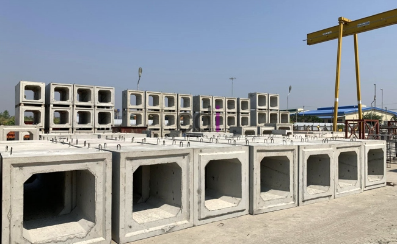

**Jual Box Culvert Precast di Cempaka Jakarta** – Hai Mitra CDI! Punya proyek yang butuh sistem drainase andal di Cempaka Jakarta? Kami punya solusinya! Produk Box Culvert Precast kami dirancang khusus untuk kebutuhan drainase modern, menawarkan kekuatan, efisiensi, dan kemudahan instalasi. 

Sistem drainase yang baik adalah fondasi penting untuk lingkungan yang sehat dan berkelanjutan. Nah, salah satu cara paling efektif untuk mewujudkannya adalah dengan menggunakan Box Culvert Precast. Mungkin Anda bertanya-tanya, apa sih Box Culvert Precast itu? Secara sederhana, ini adalah struktur beton pracetak yang dirancang untuk mengalirkan air hujan dan limbah secara efisien. Di CDI, kami menyediakan beragam pilihan Box Culvert Precast berkualitas tinggi, siap memenuhi kebutuhan proyek Anda di Cempaka Jakarta.



Berikut adalah spesifikasi Box Culvert Precast yang tersedia di Cempaka Jakarta:

## Keunggulan Memilih Box Culvert Precast dari CDI di Cempaka Jakarta:

*   **Harga Bersaing:** Kami menawarkan harga Box Culvert Precast yang kompetitif, memberikan nilai terbaik untuk investasi drainase Anda. Dapatkan kualitas premium tanpa menguras anggaran.
*   **Kualitas Terjamin:** Produk kami diproduksi dengan standar kualitas tinggi, menggunakan material pilihan yang memastikan kekuatan dan daya tahan yang optimal.
*   **Instalasi Mudah & Cepat:** Desain presisi memudahkan dan mempercepat proses instalasi, menghemat waktu dan biaya tenaga kerja proyek Anda.
*   **Awet & Tahan Lama:** Box Culvert Precast kami dirancang untuk umur panjang, tahan terhadap korosi dan kondisi cuaca ekstrem, meminimalkan biaya perawatan jangka panjang.
*   **Fleksibilitas Desain:** Tersedia dalam berbagai ukuran dan bentuk, memungkinkan penyesuaian sesuai kebutuhan spesifik proyek drainase Anda.

## Aplikasi Box Culvert Precast di Cempaka Jakarta: Solusi Drainase untuk Berbagai Kebutuhan

*   **Drainase Jalan Utama:** Ideal untuk mengelola volume air hujan besar di jalan-jalan utama Cempaka Jakarta, memastikan kelancaran lalu lintas dan mencegah genangan.
*   **Drainase Perumahan:** Solusi efektif untuk sistem drainase perumahan, mencegah banjir dan menjaga lingkungan perumahan tetap kering dan nyaman.
*   **Gorong-Gorong:** Pilihan efisien dan tahan lama untuk pembangunan gorong-gorong, mendukung infrastruktur drainase kota Cempaka Jakarta.
*   **Drainase Zona Industri:** Mampu menangani volume air limbah industri yang besar, menjaga kelestarian lingkungan di kawasan industri Cempaka Jakarta.

## Daftar Harga Box Culvert Precast di Cempaka Jakarta (Per Buah):



Catatan: Harga yang tertera adalah harga per unit Box Culvert Precast di Cempaka Jakarta.

## Mengapa Memilih Box Culvert Precast daripada Drainase Konvensional di Cempaka Jakarta?

Mari kita bandingkan manfaat Box Culvert Precast dengan sistem drainase konvensional:

\- **Efisiensi Biaya:** Box Culvert Precast umumnya lebih ekonomis dibandingkan pembangunan drainase konvensional yang membutuhkan tenaga kerja dan material terpisah.
\- **Kualitas Superior:** Material Box Culvert Precast menawarkan kualitas dan daya tahan yang lebih tinggi dibandingkan beton cor konvensional.
\- **Kecepatan Pemasangan:** Proses instalasi jauh lebih cepat dan efisien, menghemat waktu dan biaya proyek secara signifikan.
\- **Minim Perawatan:** Box Culvert Precast membutuhkan perawatan minimal, mengurangi biaya operasional jangka panjang.

## Cara Mudah Memesan Box Culvert Precast di Cempaka Jakarta

*   **Hubungi Kami:** Kirimkan detail pesanan Anda melalui email ke customercdi@gmail.com. Sertakan nama lengkap, alamat, dan jumlah Box Culvert Precast yang dibutuhkan.
*   **Penawaran Harga:** Tim kami akan segera memproses pesanan Anda dan memberikan penawaran harga yang kompetitif.
*   **Konfirmasi & Pemesanan:** Setelah Anda menyetujui penawaran, kami akan memproses pemesanan Anda.

## Tips Penting Sebelum Memesan Box Culvert Precast di Cempaka Jakarta

*   **Ukur Kebutuhan dengan Tepat:** Pastikan Anda mengetahui ukuran dan jumlah Box Culvert yang diperlukan untuk proyek Anda.
*   **Cek Ketersediaan Stok:** Hubungi kami untuk memastikan stok produk yang Anda butuhkan tersedia.
*   **Pastikan Alamat Pengiriman Akurat:** Berikan alamat pengiriman yang lengkap dan benar untuk kelancaran pengiriman.
*   **Butuh Bantuan?** Jangan ragu untuk menghubungi kami jika Anda memiliki pertanyaan atau membutuhkan bantuan dalam proses pemesanan. Kami siap melayani Anda dengan senang hati!

Pemasangan Box Culvert Precast yang tepat di Cempaka Jakarta sangat krusial untuk memastikan sistem drainase berfungsi optimal. Perhatikan faktor-faktor kunci dan hindari kesalahan pemasangan yang dapat mengurangi efektivitas aliran air. Perhitungan yang cermat dan pemilihan material berkualitas adalah kunci keberhasilan jangka panjang. Jika Anda membutuhkan informasi lebih lanjut tentang Box Culvert Precast di Cempaka Jakarta, jangan ragu untuk [hubungi kami](URL) sekarang juga! Kami siap memberikan solusi drainase terbaik untuk proyek Anda. [Jual Box Culvert Precast di Abadijaya Depok](/box-culvert/jual-box-culvert-precast-di-abadijaya-depok/) juga menyediakan Box Culvert Precast dengan kualitas terbaik yang mungkin bisa menjadi referensi tambahan untuk Anda.